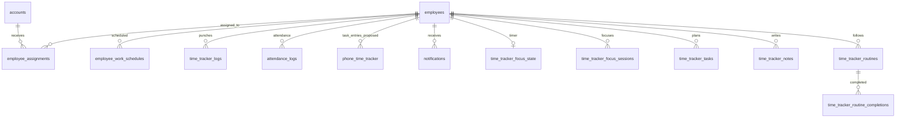

# Time Tracker database schema

Current-state scan: November 11, 2026, Asia/Manila. Source: the app's configured self-hosted Supabase Data API and code in `app/api` and `lib`. This is a design for this app's `public` schema, not for the unrelated tables visible in Studio.

## Existing model

| Domain | Tables | Role | Current rows |
| --- | --- | --- | ---: |
| People and access | `employees`, `statuses`, `roles`, `positions` | Identity, active status, permissions, profile | 324 / 6 / 6 / 61 |
| Client assignment | `accounts`, `employee_assignments` | Which account an employee works on, with effective dates | 24 / 321 |
| Schedule | `employee_work_schedules` | Employee shift start/end and effective period | 0 |
| Punches | `time_tracker_logs` | Shift start/end and breaks | 1,335 |
| Attendance corrections | `attendance_logs` | Manager-set status, date, note and audit actor | 13,225 |
| Task activity | `phone_time_tracker` | Timed/manual task entry | 4 |
| Notifications | `notifications` | Per-recipient activity messages and read state | 0 |
| Focus and planning | `time_tracker_focus_state`, `time_tracker_focus_sessions`, `time_tracker_tasks`, `time_tracker_notes`, `time_tracker_routines`, `time_tracker_routine_completions` | Flow Hub | 2 / 0 / 0 / 0 / 0 / 0 |

The app reads all of these through the server's service role, with access checks in route handlers. `assign_employee_work_schedule` is the schedule-writing function. Direct client access to these tables is not part of the current app design.

## Schema boundary

Create `workforce_portal_system` as an empty namespace first with [`scripts/create_workforce_portal_system.sql`](../scripts/create_workforce_portal_system.sql). This single-statement script does not move tables, touch rows, or change permissions on an existing schema. Run it only in the intended self-hosted CTNP Systems database.

- Keep `public.employees`, `public.statuses`, `public.roles`, `public.positions`, `public.accounts`, and `public.employee_assignments` in `public` because they are shared with other systems.
- Put new portal-owned task entries, normalized punches, work shifts, focus data, and portal notes in `workforce_portal_system` as they are introduced.
- Leave existing `public.time_tracker_*`, `public.phone_time_tracker`, `public.attendance_logs`, `public.employee_work_schedules`, and `public.notifications` in place until the app code, historical data migration, and API access change together.
- The current Supabase client defaults to `public`. Before reading a new table through the Data API, add `workforce_portal_system` to the self-hosted API's exposed schemas, grant the service role only the needed privileges, enable RLS on the table, and use `supabase.schema('workforce_portal_system')` for that query. Keep an internal-only schema unexposed if a table does not need Data API access.

The phase-one SQL for the current `phone_time_tracker` table still targets `public`. It is a compatibility step for the live app. A later migration can copy those records into a normalized `workforce_portal_system` table, verify counts and ownership, switch the app, and then retire the old table.

## What to connect now

The current portal should continue using these existing `public` tables. Do not copy them into the new schema yet:

- **Shared identity and account data:** `employees`, `statuses`, `roles`, `positions`, `accounts`, `employee_assignments`.
- **Existing portal data:** `employee_work_schedules`, `time_tracker_logs`, `phone_time_tracker`, `attendance_logs`, `notifications`, `time_tracker_focus_state`, `time_tracker_focus_sessions`, `time_tracker_tasks`, `time_tracker_notes`, `time_tracker_routines`, `time_tracker_routine_completions`.

The app already queries them through the server-side Supabase client. `workforce_portal_system` is currently an empty namespace, and a read-only Data API request returned `PGRST106` because it has not been added to the exposed schemas. That is expected at this stage. Only after a new portal-owned table is created there should the self-hosted Data API expose the schema, grant limited service-role access, and the app call `supabase.schema('workforce_portal_system')` for that table.

The first new portal-owned table should be a normalized replacement for `phone_time_tracker` (for example, `workforce_portal_system.task_time_entries`) with an entry ID, `employee_id` foreign key, `account_id` foreign key, `shift_date date`, `duration_seconds integer`, ticket number, tag, summary, and creation timestamp. Migrate the four existing entries and switch the API only after verifying their owners. Keep shared `public.employees` and `public.accounts` as foreign-key targets.

## Required changes

1. **Assign real schedules.** The schedule table is structurally present but empty. Import from an authoritative roster or use the schedule form. The database cannot derive a reliable schedule from punches; only one employee currently has a non-null legacy `shift` value.
2. **Add an ID and owner to `phone_time_tracker`.** It currently has only seven text columns: date, name, account, duration, ticket number, tagging and summary. Names are mutable and ticket numbers are not guaranteed unique. The first additive SQL step is in [`scripts/time_tracker_phase1.sql`](../scripts/time_tracker_phase1.sql). It adds `entry_id` and `employee_id`, backfills all four existing entries only when each name maps to exactly one employee, and adds a foreign key and indexes. The SQL aborts if it finds an ambiguous owner. It deliberately leaves `employee_id` nullable until the app writes it on every new entry.
3. **Update the time-entry route after phase 1.** GET should filter by `employee_id`; POST should set `employee_id` from the authenticated employee rather than the request body; DELETE should identify a single `entry_id` and authorize its owner. Then backfill any intervening rows and enforce `employee_id NOT NULL`. Keep `name` for historical display.
4. **Normalize punch history in a separate phase.** `time_tracker_logs` has quoted, spaced columns and stores timestamps and durations as text. Add a new punch table with `id bigint identity`, `employee_id bigint REFERENCES employees(id)`, `punch_type`, `occurred_at timestamptz`, `source_log_id text UNIQUE`, and `created_at timestamptz`. Keep the legacy table during a tested backfill; do not rewrite its 1,335 historical rows in place. Group punches into shift sessions using a separate `work_shifts` table only when the business rules for overnight and unclosed shifts are agreed.
5. **Keep attendance separate from task activity.** `attendance_logs` records manager overrides by employee and date. Derive attendance from actual punch sessions plus effective schedules, then apply overrides. `phone_time_tracker` measures calls/tasks, not shift presence.
6. **Use durable notes.** Flow Hub already uses `time_tracker_notes`. The legacy `/api/shift-notes` endpoint is process-local and should be migrated to `time_tracker_notes` or retired.

## Security and constraints

- Keep RLS enabled on tables exposed through the Data API. Because this app uses its own signed cookie and a server-side service role, grant table access to `service_role` and enforce employee and admin scope in route handlers. Do not grant direct `anon` or `authenticated` access merely to work around a server error.
- Foreign-key columns used for employee lookups need indexes. The proposed task-entry SQL adds an employee/date index and a ticket index. Existing schedule SQL includes an employee/effective-period index and a unique active-schedule index.
- Avoid hard-deleting punch and attendance history as part of schema migration. Use explicit corrections with actor and timestamp so reports remain auditable.
- Use `timestamptz` for instants and `date` for workforce shift dates. Present them in `Asia/Manila` at the application boundary. The legacy task date and duration text can be converted only after inspecting every existing format.

## Rollout

1. Review and apply the additive task-entry SQL in the **self-hosted** CTNP Systems SQL Editor. The connected cloud Supabase project is a different database.
2. Verify the backfilled ownership of all four existing entries and check the new columns through the Data API.
3. Deploy the matching route changes and regression tests.
4. Make `employee_id` mandatory after confirming every new entry has an owner.
5. Plan and test the punch migration separately, with a backup and reconciliation totals.

This document and SQL are prepared for review. No database schema or records were changed during this design pass.
